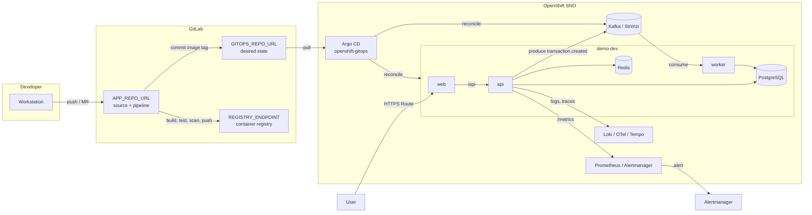
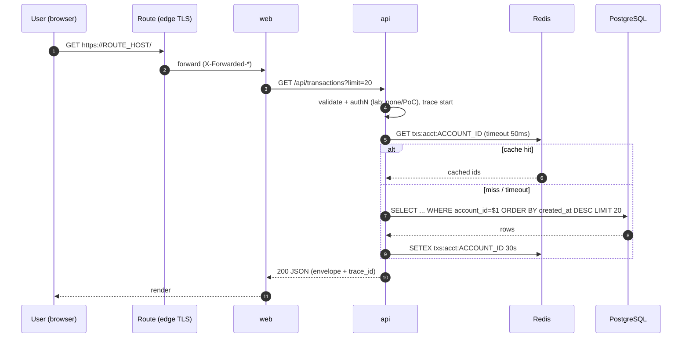
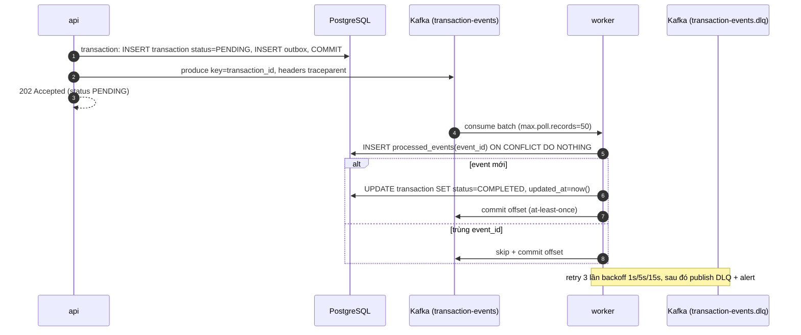
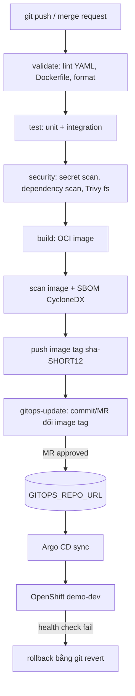
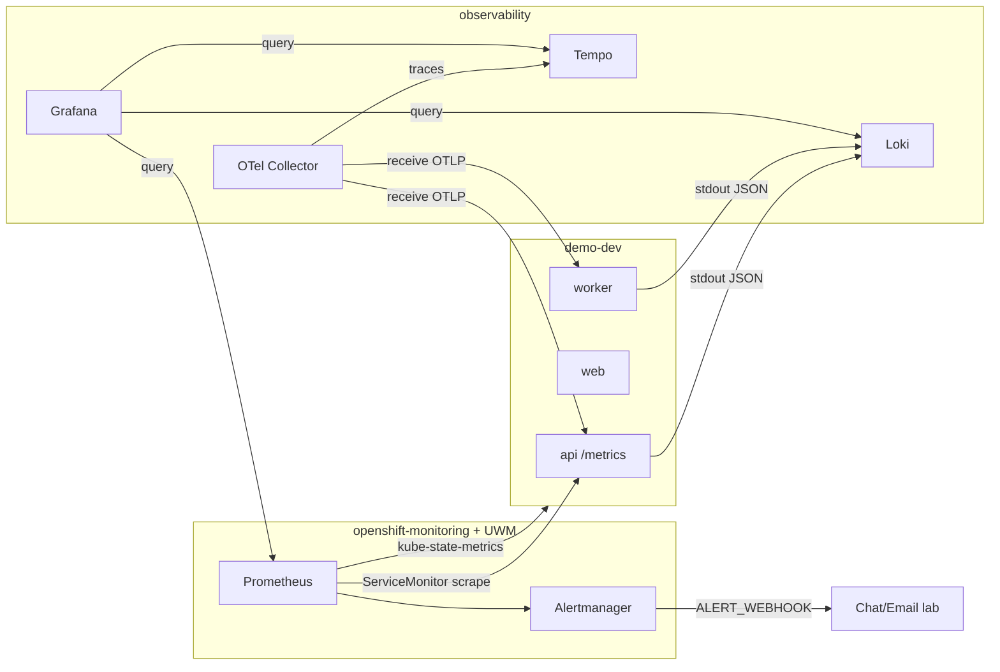
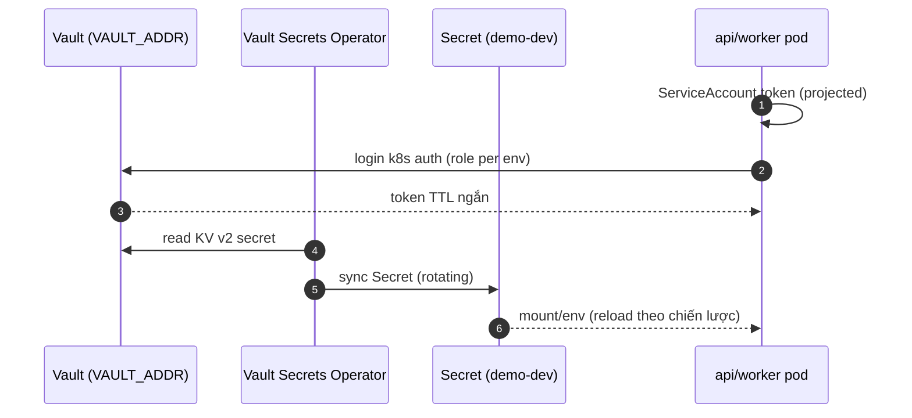
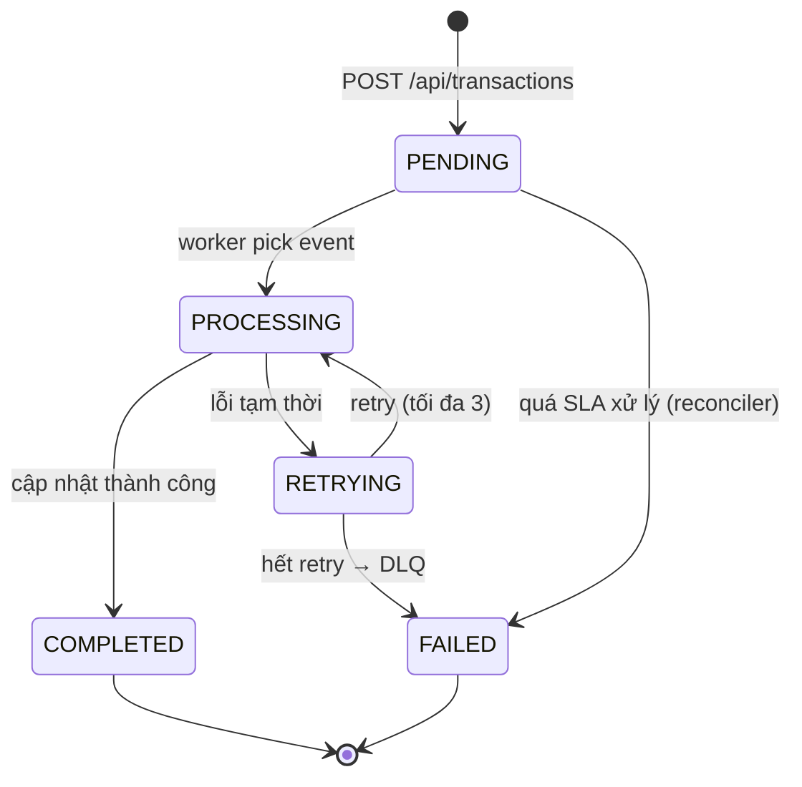

# Phase 0 - Thiết kế và Preflight

> **Dự án:** Enterprise DevOps / SRE Lab trên VMware vSphere và OpenShift SNO
> **Phase:** 0 - Design và preflight (chưa cài đặt, chưa thay đổi hạ tầng)
> **Phiên bản tài liệu:** 1.0 - draft để review
> **Nguồn tham chiếu:** `enterprise-devops-sre-lab-plan.md` (mục 2, 3, 4, 5, 8, 9, 10, 11, 12, 14, 15, 17, 18, 19)
> **Trạng thái:** Chờ xác nhận của Infra / Network / Platform owner trước khi mở Phase 1

---

## 1. Mục tiêu, phạm vi, ngoài phạm vi

### 1.1 Mục tiêu Phase 0

1. Chốt **luồng hệ thống end-to-end** (đồng bộ, bất đồng bộ, CI/CD, GitOps, observability, secret, backup) để mọi phase sau chỉ việc hiện thực hóa luồng đã thống nhất.
2. Chốt **thiết kế ứng dụng demo**: thành phần, contract API, state machine, cấu hình, probes, tài nguyên, security context, logging/metrics/tracing.
3. Chốt **thiết kế dữ liệu**: schema PostgreSQL, chiến lược migration, key/TTL Redis, topic và event contract Kafka, retention, sizing, backup.
4. Hoàn thành **preflight**: danh sách thông tin môi trường cần xác nhận, checklist hạ tầng, compatibility matrix, quy trình verify read-only, risk register.
5. Tạo đủ template (`network-plan`, `vm-inventory`, `decision-log`) để Phase 1 làm việc mà không phải quay lại thiết kế.

### 1.2 Ngoài phạm vi Phase 0

- Không tạo/sửa VM, resource pool, datastore, snapshot trên vSphere.
- Không cài OpenShift, không cấu hình DNS/NTP/firewall, không yêu cầu mở port.
- Không tạo GitLab project, runner, registry, Argo CD, Strimzi, Vault.
- Không commit secret, pull secret, kubeconfig, token hay thông tin hạ tầng nội bộ.
- Không chốt giá trị IP/domain/hostname thật: mọi giá trị môi trường để dạng placeholder (mục 2).

Mọi lệnh trong tài liệu này là **read-only** hoặc chạy trên workstation cá nhân. Không có lệnh nào mutate hệ thống công ty.

### 1.3 Định nghĩa "Done" của Phase 0

| # | Điều kiện | Bằng chứng |
|---|-----------|------------|
| 1 | Không còn blocker về IP, DNS, entitlement/pull secret | Preflight Gate PF-01..PF-12 đều `PASS` |
| 2 | Đội hạ tầng xác nhận tài nguyên (vCPU/RAM/disk/datastore/port group) | `docs/vm-inventory.md` có chữ ký xác nhận |
| 3 | Application contract và DB schema được review | `phase-0.md` mục 4, 5 ở trạng thái `Approved` |
| 4 | Compatibility matrix OCP ↔ Operator ↔ CLI đã chốt | Mục 7.4 điền đủ version, không còn `TBD` |
| 5 | Risk register có owner và mitigation cho mọi risk mức High/Critical | Mục 10 |

---

## 2. Quy ước tài liệu và placeholder

Nguyên tắc (theo mục 19.4-19.5 của plan): **không tự bịa** IP, hostname, domain, credential, registry endpoint hay storage class. Mọi giá trị môi trường dùng placeholder `<UPPER_SNAKE_CASE>`, được điền một lần trong registry dưới đây và chỉ tham chiếu lại.

### 2.1 Registry biến môi trường

| Placeholder | Ý nghĩa | Ví dụ định dạng (không dùng thật) | Nguồn xác nhận |
|---|---|---|---|
| `<CLUSTER_NAME>` | Tên cluster SNO | `sre-lab` | Platform owner |
| `<BASE_DOMAIN>` | Domain lab được cấp | `lab.example.internal` | DNS / Network |
| `<NODE_FQDN>` | FQDN node SNO | `sno-01.<BASE_DOMAIN>` | DNS |
| `<NODE_IP>` | IP tĩnh node | `10.x.y.z` | Network |
| `<NODE_MAC>` | MAC address NIC chính | `00:50:56:xx:xx:xx` | vSphere |
| `<GATEWAY>`, `<NETMASK>`, `<VLAN_ID>`, `<PORTGROUP>` | Network params | - | Network |
| `<DNS_SERVERS>` | Danh sách resolver nội bộ | - | Network |
| `<NTP_SERVERS>` | Danh sách NTP nội bộ | - | Infra |
| `<API_VIP>`, `<INGRESS_VIP>` | Địa chỉ API/Ingress theo installer | - | Infra + Red Hat doc |
| `<API_ENDPOINT>` | `api.<CLUSTER_NAME>.<BASE_DOMAIN>` | - | DNS |
| `<APPS_WILDCARD>` | `*.apps.<CLUSTER_NAME>.<BASE_DOMAIN>` | - | DNS |
| `<DATACENTER>`, `<CLUSTER_VC>`, `<RESOURCE_POOL>`, `<DATASTORE>` | vSphere placement | - | Infra |
| `<VM_NAME>` | Tên VM trên vCenter | `ocp-sno-01` | Infra |
| `<OCP_VERSION>` | Version OCP được phép cài | `4.x.y` | Platform owner |
| `<INSTALL_METHOD>` | `assisted` hoặc `agent-based` | `assisted` | Quyết định ADR-001 |
| `<PULL_SECRET_PATH>` | Đường dẫn pull secret (ngoài Git) | - | Red Hat account |
| `<STORAGE_CLASS>` | StorageClass cho PVC | - | Infra |
| `<GITLAB_URL>`, `<REGISTRY_ENDPOINT>`, `<REGISTRY_PATH_PREFIX>` | GitLab/registry | - | Platform owner |
| `<APP_REPO_URL>`, `<GITOPS_REPO_URL>` | Repo URLs | - | Platform owner |
| `<PROXY_URL>`, `<NO_PROXY_LIST>`, `<CA_BUNDLE_PATH>` | Proxy và CA tin cậy | - | Network |
| `<ALERT_WEBHOOK_URL>` | Đích nhận alert lab | - | Team |
| `<VAULT_ADDR>` | Vault endpoint (Phase 8) | - | Platform owner |

> **Quy tắc:** nếu một giá trị chưa có trong registry thì không được xuất hiện dưới dạng "giá trị thật" trong bất kỳ file nào (kể cả example trong code). Dùng placeholder và ghi vào mục 7.1.

---

## 3. Thiết kế luồng hệ thống

### 3.1 Bản đồ luồng end-to-end



Luồng được chia thành 6 luồng con có ID cố định để dùng lại trong runbook và incident report:

| ID | Luồng | Kiểu | Phase hiện thực |
|---|---|---|---|
| F1 | Request đồng bộ của người dùng | sync, HTTP | Phase 2 |
| F2 | Xử lý event giao dịch | async, Kafka | Phase 7 |
| F3 | Build → publish → GitOps → reconcile | CI/CD | Phase 3, 4 |
| F4 | Telemetry (metrics/logs/traces) | async, pull/push | Phase 5, 6 |
| F5 | Phân phối secret | pull/sync | Phase 8 |
| F6 | Backup và restore | batch | Phase 9 |

### 3.2 F1 - Luồng request đồng bộ



Đặc điểm thiết kế:

- **Không có single point of sync coupling**: API trả kết quả đọc từ PostgreSQL; Redis chỉ là cache, lỗi Redis không làm fail request đọc (degrade → đi thẳng DB).
- **Timeout budget** cho một request đọc: tổng 800 ms; phân bổ 50 ms Redis, 500 ms DB, 100 ms serialization, phần còn lại dự phòng. `context deadline` phải được set ở entrypoint.
- **Trace propagation**: `traceparent` (W3C) nhận từ Route header, tiếp tục propagate sang DB (comment `trace_id`) và Kafka (header `traceparent`).
- **Route/TLS**: edge termination + redirect HTTP→HTTPS, dùng certificate mặc định của cluster trong Phase 2; cert-manager là hạng mục P2.

### 3.3 F2 - Luồng event bất đồng bộ



Đặc điểm thiết kế:

- **At-least-once** end-to-end; consumer idempotent bằng `processed_events.event_id` unique.
- **Ordering**: key = `transaction_id` → cùng một giao dịch luôn vào cùng partition.
- **Backpressure**: `max.poll.records=50`, `max.poll.interval.ms=300000`, xử lý theo batch với transaction DB per event (đơn giản, dễ debug).
- **Failure isolation**: Kafka down không chặn F1 ghi DB; API ghi outbox và trả `202`, publisher retry từ outbox (xem 5.8). Ở Phase 2 (chưa có Kafka) API trả `201` và bỏ qua bước publish sau feature flag `FEATURE_KAFKA_ENABLED=false`.
- **Lag SLO**: 95% event xử lý < 10 s (theo mục 14.1 của plan).

### 3.4 F3 - Luồng CI → publish → GitOps → reconcile



Ranh giới trách nhiệm (theo quyết định 0.2.4 của plan):

| Thành phần | Được phép | Không được phép |
|---|---|---|
| GitLab CI | build/test/scan/push image, tạo commit/MR vào GitOps repo | `oc apply`, `kubectl`, giữ cluster-admin token |
| Argo CD | pull GitOps repo, reconcile vào cluster | build image, sửa source app |
| Developer | merge MR | sửa trực tiếp live cluster |

- **Image reference**: deploy bằng tag bất biến `sha-<short12>` ở Phase 3; chuyển sang deploy bằng **digest** khi pipeline đã ổn định (ADR-012).
- **Drift**: mọi thay đổi live không đến từ Git đều bị coi là sự cố (INC-08), `selfHeal=true` cho `demo-dev`.
- **Promotion**: `applications/demo-app/overlays/dev` → `overlays/stage` bằng MR riêng; stage chỉ bật khi còn tài nguyên (Profile B).

### 3.5 F4 - Luồng telemetry



Nguyên tắc:

- **Hai lớp monitoring**: platform (cluster-managed, không sửa tùy tiện) + user workload monitoring cho app. Không cài Prometheus Operator thứ hai.
- **Correlation**: `trace_id` có trong log, trong metric exemplar (nếu bật) và span attribute.
- **Cardinality guard**: label set của metric app bị giới hạn (mục 4.9); không dùng `account_id`, `transaction_id`, `pod` (trừ label chuẩn do Prometheus thêm).
- **Retention lab**: metrics 7 ngày, logs 3 ngày, traces 24-48 h (tiết kiệm disk trên SNO).

### 3.6 F5 - Luồng secret (Phase 8, thiết kế trước)



- Baseline Phase 2-7: secret tạo tay bằng `oc create secret` (không commit), ghi rõ đây là **tạm thời**.
- Target Phase 8: Vault KV v2 + Kubernetes auth + VSO; app đọc secret qua env/volume, **không** gọi Vault API trực tiếp (giảm coupling, dễ rotate).
- Không dùng Vault dev mode cho dữ liệu cần giữ; row trong Git chỉ chứa `VaultStaticSecret` reference, không chứa giá trị.

### 3.7 F6 - Luồng backup/restore (Phase 9)

| Đối tượng | Cơ chế | Tần suất | RPO lab | RTO lab | Nơi lưu |
|---|---|---|---|---|---|
| PostgreSQL | `pg_dump -Fc` (logical) → verify bằng `pg_restore -l` | hàng ngày + trước migration | 24 h | 2 h | PVC backup riêng + offsite lab storage |
| Kafka | Retention + replay từ topic; không backup message | - | theo retention | - | - |
| Kubernetes resources | OADP/Velero (nếu version/plugin tương thích) | hàng tuần | 7 d | 4 h | object storage lab |
| Vault | Snapshot theo hướng dẫn Vault | hàng ngày | 24 h | 2 h | ngoài cluster |
| Desired state | Git (GitOps repo) | mỗi commit | ~0 | phút | GitLab |
| App image | Registry | mỗi build | ~0 | phút | `<REGISTRY_ENDPOINT>` |

**Không** dùng vSphere VM snapshot như phương án backup/DR duy nhất (plan mục 3.3.7 và 12.3).

### 3.8 Ma trận failure mode và biện pháp thiết kế

| Failure | Ảnh hưởng | Thiết kế giảm thiểu | Phát hiện |
|---|---|---|---|
| PostgreSQL không sẵn sàng | F1 read/write fail, F2 dừng | readiness tách khỏi liveness; pool timeout ngắn; retry idempotent | `sre_lab_db_pool_wait_seconds`, alert `PostgresDown` |
| Redis không sẵn sàng | Chỉ tăng latency | cache-aside + timeout 50 ms + circuit breaker | cache error rate, p95 latency |
| Kafka broker down | F2 dừng, event chờ | outbox + retry; producer `acks=all`, `retries` hữu hạn | consumer lag, producer errors |
| Consumer chết giữa batch | Event xử lý lại | idempotency `processed_events` | lag tăng, `rebalances_total` |
| Pod bị OOMKilled | Downtime cục bộ | requests/limits thực tế, JIT/heap tuning | `kube_pod_container_status_last_terminated_reason` |
| PVC đầy | DB write fail | quota, alert 80/90%, retention ngắn | `kubelet_volume_stats_used_bytes` |
| Argo CD drift | Trạng thái lệch Git | `selfHeal`, alert `OutOfSync > 10m` | Argo metrics |
| SNO node down | Toàn bộ workload mất | Chấp nhận (không phải HA); có recovery runbook | node-exporter, `oc get nodes` |
| Certificate hết hạn | Route/API lỗi TLS | theo dõi expiry, alert 30 ngày | cert metrics |

---

## 4. Thiết kế ứng dụng

### 4.1 Inventory thành phần

| Component | Trách nhiệm | Loại workload | Replicas (lab) | Stateful |
|---|---|---|---|---|
| `web` | UI tạo/list giao dịch, gọi API qua Route nội bộ | Deployment + Service + Route | 1 | Không |
| `api` | REST API, validate, ghi DB, publish event | Deployment + Service + Route | 2 | Không |
| `worker` | Kafka consumer, cập nhật trạng thái | Deployment | 2 | Không |
| `db-migrate` | Chạy migration schema | Job (Argo `PreSync` hook) | 1 | Không |
| `postgres` | Lưu giao dịch | StatefulSet + PVC | 1 | Có |
| `redis` | Cache đọc | Deployment (ephemeral) | 1 | Không (chấp nhận mất) |
| `kafka` | Event stream | Strimzi `Kafka` CR (namespace `kafka`) | 1 broker | Có (PVC) |

**Quyết định ngôn ngữ/stack (ADR-009, cần chốt):** ưu tiên stack team quen (Java Spring Boot, .NET hoặc Node.js). Tài liệu này không phụ thuộc ngôn ngữ; contract, probe, metric và schema là bắt buộc như nhau.

### 4.2 Contract API

Base path: `/api`. Tất cả response JSON UTF-8, có `X-Request-Id` và `traceparent` header ra/vào.

| Method | Path | Mục đích | Thành công | Lỗi |
|---|---|---|---|---|
| `POST` | `/api/transactions` | Tạo giao dịch demo | `201` (F1 only) / `202` (khi bật Kafka) | `400`, `409`, `422`, `503` |
| `GET` | `/api/transactions` | List phân trang | `200` | `400` |
| `GET` | `/api/transactions/{id}` | Trạng thái một giao dịch | `200` | `404` |
| `GET` | `/health/live` | Liveness (không kiểm tra dependency) | `200` | - |
| `GET` | `/health/ready` | Readiness (DB bắt buộc; Kafka theo `KAFKA_REQUIRED`) | `200` | `503` |
| `GET` | `/metrics` | Prometheus exposition | `200` | - |
| `GET` | `/api/version` | Build info (`sha`, `version`, `build_time`) | `200` | - |

**Request tạo giao dịch**

```json
{
  "account_id": "acc-000001",
  "counterparty_id": "acc-000042",
  "amount": 125.50,
  "currency": "VND",
  "type": "TRANSFER",
  "note": "demo"
}
```

Header bắt buộc: `Idempotency-Key` (UUID hoặc chuỗi ≤ 64 ký tự). Thiếu header → `400`.

**Validation rules**

| Field | Rule |
|---|---|
| `account_id` | bắt buộc, tồn tại trong `accounts`, ≤ 32 ký tự |
| `counterparty_id` | bắt buộc, khác `account_id`, tồn tại trong `accounts` |
| `amount` | > 0, ≤ 1e12, tối đa 2 chữ số thập phân |
| `currency` | ISO-4217, 3 ký tự hoa, khớp currency của `account_id` |
| `type` | `TRANSFER` \| `DEPOSIT` \| `WITHDRAWAL` |
| `note` | tùy chọn, ≤ 200 ký tự, không log nguyên văn |

**Response lỗi (envelope thống nhất)**

```json
{
  "error": {
    "code": "VALIDATION_ERROR",
    "message": "amount must be greater than 0",
    "request_id": "…",
    "trace_id": "…"
  }
}
```

Mã lỗi dùng trong lab: `VALIDATION_ERROR` (400), `IDEMPOTENCY_CONFLICT` (409), `UNPROCESSABLE` (422), `NOT_FOUND` (404), `DEPENDENCY_UNAVAILABLE` (503), `INTERNAL` (500).

**Response list**

```json
{
  "items": [ { "id": "…", "status": "COMPLETED", "amount": 125.5, "currency": "VND", "created_at": "…" } ],
  "next_cursor": "…",
  "trace_id": "…"
}
```

Phân trang bằng cursor `created_at,id` (không dùng offset để tránh chậm khi dữ liệu tăng).

### 4.3 State machine giao dịch



Chỉ worker (và reconciler) được đổi trạng thái; API chỉ tạo `PENDING`. Transition phải kiểm tra trạng thái nguồn trong `WHERE` để tránh race (`UPDATE … WHERE id=$1 AND status='PROCESSING'`).

### 4.4 Probes và vòng đời

| Probe | Endpoint | Tham số đề xuất | Ghi chú |
|---|---|---|---|
| startupProbe | `/health/live` | `initialDelay 5s`, `period 5s`, `failureThreshold 24` | Cho phép app khởi động chậm tới 120 s |
| livenessProbe | `/health/live` | `period 10s`, `timeout 2s`, `failureThreshold 3` | **Không** phụ thuộc DB/Kafka |
| readinessProbe | `/health/ready` | `period 5s`, `timeout 2s`, `failureThreshold 2` | DB ping + pool khả dụng; Kafka chỉ khi `KAFKA_REQUIRED=true` |

Vòng đời pod:

1. `SIGTERM` → ngừng nhận request mới (readiness fail ngay).
2. `preStop` sleep 5 s để kịp endpoint removal.
3. Drain in-flight với deadline 20 s; worker `consumer.wakeup()` rồi commit offset đã xử lý.
4. `terminationGracePeriodSeconds: 30`.

### 4.5 Cấu hình và biến môi trường

| Biến | Nguồn | Bắt buộc | Ghi chú |
|---|---|---|---|
| `APP_ENV` | ConfigMap | Có | `dev` \| `stage` |
| `HTTP_PORT` | ConfigMap | Có | `8080` |
| `LOG_LEVEL` | ConfigMap | Có | `info` mặc định, `debug` chỉ khi troubleshoot |
| `LOG_FORMAT` | ConfigMap | Có | `json` (bắt buộc ở cluster) |
| `DATABASE_URL` / `DB_*` | **Secret** | Có | Không log, không echo |
| `DB_POOL_MAX` | ConfigMap | Có | Xem 5.5 |
| `DB_STATEMENT_TIMEOUT_MS` | ConfigMap | Có | `3000` |
| `REDIS_URL` | **Secret** | Không (Phase 7+) | Rỗng → tắt cache |
| `REDIS_TIMEOUT_MS` | ConfigMap | Không | `50` |
| `KAFKA_BOOTSTRAP` | ConfigMap | Không | `kafka-kafka-bootstrap.kafka.svc:9092` (placeholder) |
| `KAFKA_TOPIC` | ConfigMap | Không | `transaction-events` |
| `KAFKA_CONSUMER_GROUP` | ConfigMap | Không | `sre-lab-worker` |
| `KAFKA_REQUIRED` | ConfigMap | Không | `false` cho lab, tránh readiness flap |
| `FEATURE_KAFKA_ENABLED` | ConfigMap | Có | `false` ở Phase 2, `true` từ Phase 7 |
| `OTEL_EXPORTER_OTLP_ENDPOINT` | ConfigMap | Không | Trống = tắt tracing |
| `OTEL_SERVICE_NAME`, `OTEL_RESOURCE_ATTRIBUTES` | ConfigMap | Không | `service.namespace`, `deployment.environment` |
| `OTEL_TRACES_SAMPLER_ARG` | ConfigMap | Không | `1.0` (lab) |

Quy tắc: **không** đặt secret trong ConfigMap; **không** đặt `DATABASE_URL` có password trong manifest; tất cả secret ở Phase 2 tạo tay, từ Phase 8 lấy từ Vault.

### 4.6 Tài nguyên và scheduling

| Component | requests CPU | requests Mem | limits CPU | limits Mem | Ghi chú |
|---|---|---|---|---|---|
| `web` | 50m | 64Mi | 200m | 128Mi | static files |
| `api` | 250m | 384Mi | 1000m | 768Mi | heap ≤ 60% limit |
| `worker` | 200m | 384Mi | 800m | 768Mi | batch nhỏ |
| `postgres` | 500m | 1Gi | 2000m | 2Gi | `shared_buffers` 512MB |
| `redis` | 100m | 128Mi | 500m | 384Mi | `maxmemory 256mb` |
| `kafka` (1 broker) | 1000m | 1Gi | 2000m | 2Gi | heap 1Gi, PVC 10Gi |
| `db-migrate` | 100m | 128Mi | 500m | 256Mi | Job ngắn |

Tổng requests của app≈ 2.1 vCPU / 3.1 GiB; nằm trong ngân sách Profile B sau khi trừ platform (mục 7.2 có bảng capacity).

Nguyên tắc:
- Không đặt `limits.memory` sát `requests.memory` (gây OOMKilled khi burst) và không đặt CPU limit quá thấp (throttling làm sai SLO latency).
- Mọi container phải có cả requests và limits; LimitRange của namespace là chốt chặn cuối.
- `topologySpreadConstraints` không cần trên SNO (1 node), nhưng giữ `podAntiAffinity` preferred để sẵn sàng cho multi-node sau này.

### 4.7 Security context và phân quyền

```yaml
securityContext:            # pod level
  runAsNonRoot: true
  seccompProfile:
    type: RuntimeDefault
containers:
  - name: api
    securityContext:
      allowPrivilegeEscalation: false
      readOnlyRootFilesystem: true
      capabilities:
        drop: ["ALL"]
```

- SCC: `restricted-v2` cho mọi workload app. PostgreSQL dùng image hỗ trợ arbitrary UID (Red Hat `rhel9/postgresql-*`) hoặc cấu hình `fsGroup` phù hợp; **không** dùng `anyuid` trừ khi có ADR.
- Mỗi workload một `ServiceAccount` riêng (`web`, `api`, `worker`, `db-migrate`), không dùng `default`.
- RBAC: app SA không có quyền trên API Kubernetes; `db-migrate` chỉ có quyền đọc ConfigMap/Secret của namespace.
- `readOnlyRootFilesystem: true` → mount `emptyDir` cho `/tmp` và thư mục cache runtime.
- NetworkPolicy chi tiết ở mục 6.2.

### 4.8 Logging và trace convention

Log JSON, một dòng một event, bắt buộc các field:

| Field | Ví dụ | Ghi chú |
|---|---|---|
| `ts` | `2026-01-01T00:00:00.000Z` | ISO-8601 UTC |
| `level` | `info` \| `warn` \| `error` | |
| `svc` | `api` | tên service |
| `env` | `dev` | |
| `ver` | `sha-a1b2c3d` | image tag |
| `trace_id`, `span_id` | hex | từ OTel context |
| `request_id` | uuid | |
| `msg` | chuỗi ngắn | |
| `http.method`, `http.route`, `http.status`, `http.duration_ms` | | access log |
| `db.statement_name`, `db.rows`, `db.duration_ms` | | **không** log raw SQL có tham số |
| `err.type`, `err.msg` | | không chứa stack đầy đủ ở `info` |

**Redaction bắt buộc:** `Authorization`, `Cookie`, `Set-Cookie`, `password`, `token`, `secret`, `note`, số tài khoản đầy đủ, dữ liệu cá nhân. Có unit test cho logger redaction.

Trace: dùng OpenTelemetry SDK, propagate W3C `traceparent`. Span bắt buộc:

`http.server` (route, method, status) → `db.query` (`db.system=postgresql`, `db.operation`) → `messaging.publish` (`messaging.system=kafka`, `messaging.destination.name`) → `messaging.process` ở worker (span link tới producer span).

### 4.9 Metric catalog

Tiền tố `sre_lab_`. Không dùng label có cardinality cao.

| Metric | Type | Labels | Mục đích |
|---|---|---|---|
| `sre_lab_http_requests_total` | counter | `route`, `method`, `status` | SLI availability, error rate |
| `sre_lab_http_request_duration_seconds` | histogram | `route`, `method` | SLI latency p50/p95/p99 |
| `sre_lab_http_in_flight` | gauge | `route` | saturation |
| `sre_lab_transactions_created_total` | counter | `type`, `status` | business rate |
| `sre_lab_transaction_processing_seconds` | histogram | `outcome` | event latency SLO |
| `sre_lab_db_pool_in_use` / `_max` | gauge | - | pool saturation |
| `sre_lab_db_pool_wait_seconds` | histogram | - | pool timeout signal |
| `sre_lab_cache_requests_total` | counter | `result` (`hit`/`miss`/`error`) | cache health |
| `sre_lab_kafka_produce_errors_total` | counter | `topic` | producer health |
| `sre_lab_kafka_consumed_total` | counter | `topic`, `result` | throughput/DLQ |
| `sre_lab_build_info` | gauge | `version`, `git_sha` | version tracking |

Không được dùng làm label: `account_id`, `transaction_id`, `request_id`, `trace_id`, `email`, `pod_ip`.

SLI → công thức (PromQL rút gọn, dùng trong Phase 5):

```promql
# Availability
sum(rate(sre_lab_http_requests_total{status!~"5.."}[5m]))
  / sum(rate(sre_lab_http_requests_total[5m]))

# Latency p95
histogram_quantile(0.95,
  sum by (le) (rate(sre_lab_http_request_duration_seconds_bucket[5m])))

# Error rate
sum(rate(sre_lab_http_requests_total{status=~"5.."}[5m]))
  / sum(rate(sre_lab_http_requests_total[5m]))

# Event processing p95
histogram_quantile(0.95,
  sum by (le) (rate(sre_lab_transaction_processing_seconds_bucket[5m])))
```

### 4.10 Reliability patterns trong app

| Pattern | Áp dụng | Chi tiết |
|---|---|---|
| Timeout | mọi outbound call | HTTP client 2 s; DB statement 3 s; Redis 50 ms; Kafka produce 5 s |
| Retry | idempotent operation | exponential backoff + jitter, tối đa 3 lần; không retry `4xx` |
| Circuit breaker | Redis, Kafka publish | mở sau 5 lỗi liên tiếp trong 30 s, half-open sau 30 s |
| Bulkhead | connection pool | pool nhỏ, timeout ngắn, không chia sẻ pool giữa API và worker |
| Idempotency | POST tạo giao dịch | `Idempotency-Key` unique; trả lại kết quả cũ với `200`/`409` theo semantics đã chốt |
| Graceful shutdown | tất cả pod | mục 4.4 |
| Resource guard | body size, rate | body ≤ 16 KB; rate limit 20 rps/instance (lab) |
| Fail fast | startup | validate config, fail nếu thiếu biến bắt buộc |

---

## 5. Thiết kế cơ sở dữ liệu

### 5.1 Phân loại dữ liệu

| Loại | Ví dụ | Xử lý |
|---|---|---|
| Dữ liệu giả lập nghiệp vụ | `transactions`, `accounts` | Sinh bằng seed script; **không** mang dữ liệu thật của công ty |
| Dữ liệu vận hành | metrics, logs | Retention ngắn, không log payload |
| Secret | DB password, Vault token | Không vào Git, không vào log |
| Dữ liệu cá nhân giả | `owner_ref` dạng `cust-000123` | Pseudonymous, không map tới người thật |

Chính sách: nếu cần dữ liệu giống thật → dùng dữ liệu tổng hợp (synthetic). Không copy bảng production.

### 5.2 Schema PostgreSQL (draft, chưa apply)

```sql
-- 001_init.up.sql
CREATE TABLE accounts (
    id           text PRIMARY KEY,                 -- 'acc-000001'
    owner_ref    text NOT NULL,                    -- 'cust-000001' (pseudonymous)
    currency     char(3) NOT NULL,
    status       text NOT NULL DEFAULT 'ACTIVE'
                 CHECK (status IN ('ACTIVE','BLOCKED')),
    created_at   timestamptz NOT NULL DEFAULT now()
);

CREATE TABLE transactions (
    id               uuid PRIMARY KEY,
    account_id       text  NOT NULL REFERENCES accounts(id),
    counterparty_id  text  NOT NULL REFERENCES accounts(id),
    amount           numeric(18,2) NOT NULL CHECK (amount > 0),
    currency         char(3) NOT NULL,
    type             text NOT NULL
                     CHECK (type IN ('TRANSFER','DEPOSIT','WITHDRAWAL')),
    status           text NOT NULL DEFAULT 'PENDING'
                     CHECK (status IN ('PENDING','PROCESSING','RETRYING','COMPLETED','FAILED')),
    idempotency_key  text NOT NULL,
    note             text,
    failure_reason   text,
    event_id         uuid,                          -- event publish lần đầu
    created_at       timestamptz NOT NULL DEFAULT now(),
    updated_at       timestamptz NOT NULL DEFAULT now(),
    CONSTRAINT transactions_idem_uk UNIQUE (idempotency_key),
    CONSTRAINT transactions_amount_scale_ck
      CHECK (amount = round(amount, 2))
);

CREATE INDEX transactions_account_created_idx
    ON transactions (account_id, created_at DESC, id);
CREATE INDEX transactions_status_pending_idx
    ON transactions (status) WHERE status IN ('PENDING','PROCESSING','RETRYING');

-- consumer idempotency
CREATE TABLE processed_events (
    event_id     uuid PRIMARY KEY,
    topic        text NOT NULL,
    partition_id integer NOT NULL,
    offset_id    bigint NOT NULL,
    processed_at timestamptz NOT NULL DEFAULT now()
);

-- transactional outbox (Phase 7)
CREATE TABLE outbox_events (
    id             uuid PRIMARY KEY,
    aggregate_type text NOT NULL,
    aggregate_id   uuid NOT NULL,
    event_type     text NOT NULL,
    payload        jsonb NOT NULL,
    headers        jsonb NOT NULL DEFAULT '{}'::jsonb,
    status         text NOT NULL DEFAULT 'NEW'
                   CHECK (status IN ('NEW','PUBLISHED','FAILED')),
    attempts       integer NOT NULL DEFAULT 0,
    created_at     timestamptz NOT NULL DEFAULT now(),
    published_at   timestamptz
);
CREATE INDEX outbox_status_idx ON outbox_events (status, created_at)
    WHERE status = 'NEW';
```

Ghi chú thiết kế:

- `amount` dùng `numeric(18,2)`, không bao giờ dùng float. Constraint scale chống dữ liệu 3 chữ số thập phân.
- `idempotency_key` unique ở DB là **nguồn chính xác cuối cùng**; Redis chỉ là fast-path.
- `processed_events` giữ nguyên (không purge) trong lab; Phase 9 có thể thêm job xoá theo `processed_at < now() - interval '30 days'`.
- `outbox_events` chỉ dùng khi bật Kafka; bảng rỗng hoàn toàn ở Phase 2.
- Không dùng `serial`; ID nghiệp vụ sinh ở app (UUID v7 để sắp xếp theo thời gian, tránh index fragmentation).

### 5.3 Query pattern chính

| Query | Tần suất (lab) | Index dùng |
|---|---|---|
| `SELECT … FROM transactions WHERE id=$1` | cao | PK |
| `SELECT … WHERE account_id=$1 ORDER BY created_at DESC, id DESC LIMIT $2` | cao | `transactions_account_created_idx` |
| `INSERT INTO transactions …` | 5 rps | PK + unique idempotency |
| `UPDATE transactions SET status=… WHERE id=$1 AND status='PROCESSING'` | 5 rps | PK |
| `SELECT * FROM outbox_events WHERE status='NEW' ORDER BY created_at LIMIT 100` | 5 rps (poll) | `outbox_status_idx` |
| Reconciler: `PENDING` quá 5 phút | mỗi phút | `transactions_status_pending_idx` |

Không dùng `SELECT *` ở tầng API; mọi query có `LIMIT`; câu list phải dùng cursor (keyset pagination).

### 5.4 Migration strategy

- Công cụ: Flyway (Java) hoặc `node-pg-migrate`/`Alembic` theo stack (ADR-009). Một công cụ duy nhất cho toàn project.
- File `database/migrations/V001__init.sql`, forward-only, không sửa file đã apply.
- Chạy bằng Job `db-migrate` được Argo CD đánh dấu `PreSync` hook: migration xong mới rollout app.
- Migration phải **backward-compatible** (expand → migrate → contract) để rollback app không vỡ schema.
- Advisory lock (`pg_advisory_lock`) để chống chạy song song.
- Số migration chạy đồng thời = 1; Job có `backoffLimit: 0` và phải fail rõ ràng.
- Trước Phase 9: dump trước mỗi migration để có restore point.

### 5.5 Ngân sách connection và tham số PostgreSQL

`max_connections = 100` (single instance, 2 vCPU).

| Consumer | Pool tối đa | Ghi chú |
|---|---|---|
| `api` (2 replicas) | 2 × 10 = 20 | user-facing, timeout ngắn |
| `worker` (2 replicas) | 2 × 5 = 10 | batch |
| `db-migrate` | 1 | chạy ngắn |
| metrics exporter | 3 | |
| admin/DBA (dự phòng) | 10 | `psql`, backup |
| **Tổng dự phòng** | ≤ 60 | còn 40 slot cho replication/maintenance |

Tham số khởi điểm: `shared_buffers=512MB`, `effective_cache_size=1GB`, `work_mem=16MB`, `maintenance_work_mem=128MB`, `max_wal_size=1GB`, `statement_timeout=3000ms` (app), `idle_in_transaction_session_timeout=60s`, `log_min_duration_statement=500ms`.

`DB_POOL_MAX` mỗi replica **không** vượt 10; tăng replica phải tính lại tổng để không vượt `max_connections`.

### 5.6 Thiết kế Redis

| Key | Kiểu | TTL | Dùng cho |
|---|---|---|---|
| `tx:item:{transaction_id}` | string (JSON) | 300 s | cache chi tiết giao dịch |
| `tx:acct:{account_id}:first20` | string (JSON list id) | 30 s | cache danh sách |
| `idem:{idempotency_key}` | string (`transaction_id`) | 24 h | fast-path idempotency |
| `rl:{account_id}:{minute}` | counter | 60 s | rate limit nội bộ (tùy chọn) |

Nguyên tắc:
- Cache-aside; **không** cache-aside cho dữ liệu vừa ghi: sau insert phải `DEL` key liên quan (write-invalidate, không write-through).
- Redis là ephemeral: mất dữ liệu chỉ tăng latency, không sai dữ liệu.
- `maxmemory 256mb`, `maxmemory-policy allkeys-lru`, không bật persistence trong lab.
- Mọi lệnh Redis có timeout 50 ms; lỗi Redis không được map thành `5xx` của API.

### 5.7 Kafka: topic và event contract

| Thuộc tính | Giá trị lab | Lý do |
|---|---|---|
| Topic chính | `transaction-events` | theo plan mục 10.2 |
| Partitions | 3 | đủ cho 2-3 consumer replica, không vượt 1 broker |
| Replication factor | 1 | SNO chỉ 1 node → **không phải HA** (ghi rõ trong runbook) |
| `min.insync.replicas` | 1 | bắt buộc khớp RF=1 |
| Retention | 24 h (`retention.ms=86400000`) | tiết kiệm disk, đủ cho replay lab |
| Cleanup policy | `delete` | |
| Compression | `producer` | |
| `max.message.bytes` | 1 MiB | |
| Key | `transaction_id` | ordering theo giao dịch |
| Group | `sre-lab-worker` | |
| DLQ | `transaction-events.dlq` | retry 3 lần rồi chuyển |
| Retry | `transaction-events.retry` (tùy chọn) hoặc in-process backoff | Phase 7 chọn 1 |

Event envelope (v1):

```json
{
  "event_id": "018f2b0e-…",
  "event_type": "transaction.created",
  "event_version": 1,
  "occurred_at": "2026-01-01T00:00:00.000Z",
  "producer": "sre-lab-api",
  "trace_id": "4bf92f3577b34da6a3ce929d0e0e4736",
  "payload": {
    "transaction_id": "018f2b0e-…",
    "account_id": "acc-000001",
    "counterparty_id": "acc-000042",
    "amount": 125.50,
    "currency": "VND",
    "type": "TRANSFER",
    "status": "PENDING"
  }
}
```

Header Kafka: `traceparent`, `content-type=application/json`, `event_version`.

Quy tắc schema evolution:
- Thêm field optional → giữ `event_version`, consumer bỏ qua field lạ.
- Đổi/xóa field → tăng `event_version`, publish song song hoặc migrate consumer trước.
- Consumer **luôn** tolerant reader; không fail khi gặp `event_version` lớn hơn (log + skip vào DLQ có kiểm soát).
- Không đưa PII/secret vào payload.

### 5.8 Transactional outbox và idempotency

- API: `INSERT transactions` + `INSERT outbox_events` trong **một** transaction DB → không mất event khi crash sau commit.
- Publisher: hoặc một thread trong `api`, hoặc `worker` riêng; poll `status='NEW'`, publish, update `PUBLISHED`, `attempts++` khi fail, quá 10 lần → `FAILED` + alert.
- Consumer: dedupe bằng `processed_events.event_id` (unique) trong cùng transaction với `UPDATE transactions` để đảm bảo đúng-một-lần về mặt hiệu ứng.
- Idempotency ở API: kiểm tra Redis trước (fast path), sau đó DB unique; khi trùng key phải trả **cùng** kết quả thay vì tạo bản ghi mới.
- Ghi rõ trong runbook: "at-least-once delivery + exactly-once effect".

### 5.9 Sizing, retention, backup dữ liệu

Giả định lab: 5 giao dịch/giây peak, 1 KB/event bao gồm overhead.

| Đối tượng | Tính toán | Kết quả | Cấp phát |
|---|---|---|---|
| PostgreSQL rows | 5 rps × 86 400 = 432 000 rows/ngày, ~450 B/row kèm index | ~195 MB/ngày | PVC **20 GiB**, giữ 30 ngày (~6 GB) |
| Kafka messages | 432 000/ngày × ~1.3 overhead | ~560 MB/ngày | PVC **10 GiB**, retention 24 h |
| Redis | cache + counter | < 64 MB | ephemeral |
| Backup PostgreSQL | dump nén ~15% dữ liệu | ~1 GB/bản | PVC backup **10 GiB**, giữ 7 bản |

Ngưỡng cảnh báo: PVC > 80% (warning) / > 90% (critical). Khi chạm 80% phải có hành động ghi trong runbook (purge, tăng PVC nếu SC cho phép expansion).

---

## 6. Namespace và network topology (thiết kế, chưa tạo)

### 6.1 Namespace map

| Namespace | Tạo ở phase | Nội dung | Quota |
|---|---|---|---|
| `demo-dev` | Phase 2 | web, api, worker, postgres, redis, db-migrate | CPU 4 / Mem 8Gi / PVC 30Gi |
| `kafka` | Phase 7 | Strimzi operator + Kafka CR | CPU 3 / Mem 6Gi / PVC 20Gi |
| `openshift-gitops` | Phase 4 | Argo CD (cluster-managed) | - |
| `observability` | Phase 5-6 | Grafana, Loki, OTel, Tempo | CPU 3 / Mem 6Gi / PVC 20Gi |
| `vault` | Phase 8 | Vault + VSO | CPU 1 / Mem 2Gi |
| `security` | Phase 8 (tùy chọn) | Trivy Operator, SonarQube | - |
| `backup` | Phase 9 | OADP/Velero | - |

**Quyết định (ADR-006):** Phase 2 đặt PostgreSQL trong `demo-dev` để giảm số bước; tách sang namespace `database` chỉ khi cần mô phỏng ranh giới team. Điều kiện tách: NetworkPolicy + secret đã ổn định.

Không tạo sẵn toàn bộ namespace; mỗi namespace ra đời cùng phase của nó để giữ tài nguyên SNO.

### 6.2 Ma trận NetworkPolicy (thiết kế)

| Nguồn → Đích | Port | Cho phép | Ghi chú |
|---|---|---|---|
| `openshift-ingress` → `web`, `api` | 8080 | Có | Route |
| `web` → `api` | 8080 | Có | gọi qua Service |
| `api` → `postgres` | 5432 | Có | |
| `worker` → `postgres` | 5432 | Có | |
| `api` → `redis` | 6379 | Có | |
| `api`, `worker` → `kafka` | 9092 | Có | internal listener |
| `openshift-user-workload-monitoring` → `api`, `worker`, `web` | 8080 (`/metrics`) | Có | ServiceMonitor |
| `observability` (OTel) ← app | 4317 | Có | OTLP gRPC |
| Internet → bất kỳ pod | * | **Không** | egress/ingress mặc định deny sau Phase 8 |
| `db-migrate` → `postgres` | 5432 | Có | |

Baseline Phase 2: chưa bật default-deny (tránh debug khó); Phase 8 bật deny-all + bảng trên. Ghi rõ thời điểm bật trong `decision-log`.

### 6.3 Route/Ingress design

| Route | Host (placeholder) | TLS | Backend |
|---|---|---|---|
| `demo-web` | `demo.<APPS_WILDCARD>` | edge, redirect | `web:8080` |
| `demo-api` | `api-demo.<APPS_WILDCARD>` | edge, redirect | `api:8080` |

Có thể bỏ Route API riêng nếu UI gọi cùng origin qua path `/api` (đơn giản hơn, ít CORS). Quyết định ADR-011: **giữ 1 Route duy nhất** (`web` proxy `/api` → `api`) cho Phase 2, thêm Route API riêng khi cần test trực tiếp.

---

## 7. Preflight: thông tin và checklist cần xác nhận

### 7.1 Bảng thông tin môi trường (blocker nếu chưa có)

| ID | Thông tin | Dùng cho | Ảnh hưởng nếu thiếu | Nguồn | Trạng thái |
|---|---|---|---|---|---|
| I-01 | Quyền tạo VM (vCenter/cluster/resource pool/datastore) | Phase 1 | Không provision được | Infra | `TBD` |
| I-02 | Capacity: vCPU/RAM/datastore còn trống | Sizing | Không rollout Profile B | Infra | `TBD` |
| I-03 | Port group/VLAN được phép | Network | VM không vào được subnet đúng | Network | `TBD` |
| I-04 | IP tĩnh + subnet/gateway | SNO | Không cài được node | Network | `TBD` |
| I-05 | DNS record `api.<cluster>.<domain>` + wildcard `*.apps` | Route/API | Cluster không healthy | DNS | `TBD` |
| I-06 | DNS forward/reverse cho node FQDN | Installer validation | Install fail | DNS | `TBD` |
| I-07 | NTP nội bộ | TLS/cert/etcd | Install/upgrade lỗi | Infra | `TBD` |
| I-08 | Đường đi tới registry Red Hat hoặc mirror | Pull image | Install treo | Network | `TBD` |
| I-09 | Proxy/no-proxy và CA bundle (nếu có) | Installer, image pull, GitLab | Fail toàn bộ | Network | `TBD` |
| I-10 | Pull secret + entitlement còn hạn | Install, Operator | Không cài/tải được | Platform owner | `TBD` |
| I-11 | OCP version được phép + installer method | Phase 1 | Không chốt được compatibility | Platform owner | `TBD` |
| I-12 | StorageClass + quyền vCenter cho CSI | PVC (DB, Kafka, monitoring) | Không có PV | Infra | `TBD` |
| I-13 | GitLab instance, project namespace | Phase 3 | Không có CI | Platform owner | `TBD` |
| I-14 | Runner placement (shared / VM riêng) | Phase 3 | Pipeline không chạy | Platform owner | `TBD` |
| I-15 | Registry endpoint + path prefix + quota | Phase 3 | Không push image | Platform owner | `TBD` |
| I-16 | GitOps repo + credential model (deploy key/PAT) | Phase 4 | Argo không sync | Platform owner | `TBD` |
| I-17 | Alert webhook đích | Phase 5 | Alert không tới nơi | Team | `TBD` |
| I-18 | Có được expose 6443 + 80/443 từ subnet cho phép | Truy cập cluster | Không login/không vào app | Network | `TBD` |
| I-19 | Cơ chế API/Ingress VIP cho SNO theo installer | Install | Install fail | Infra + Red Hat doc | `TBD` |
| I-20 | Chính sách dữ liệu: được phép dùng dữ liệu giả lập | App/DB | Không được seed dữ liệu | Security/Compliance | `TBD` |

### 7.2 Checklist hạ tầng và platform

- [ ] Đã điền đủ I-01..I-20 (không còn `TBD`).
- [ ] Sizing chốt theo Profile `<A|B|C>`: `<vCPU>` / `<RAM>` / `<DISK>`.
- [ ] Bảng capacity đã tính: platform overhead + app requests + headroom ≥ 20%.
- [ ] `disk.EnableUUID=TRUE` cho VM SNO (theo yêu cầu installer trên VMware).
- [ ] Datastore latency/IOPS đủ cho etcd + PostgreSQL + Kafka (ghi ngưỡng mong đợi vào `vm-inventory`).
- [ ] Xác nhận **không** dùng VM snapshot như backup/DR.
- [ ] Firewall rule đã được Network team phê duyệt theo bảng source/destination/port (mục 6.2 + registry egress).
- [ ] NTP/DNS đã sẵn sàng và kiểm chứng được từ subnet của VM.
- [ ] StorageClass hỗ trợ: access mode cần dùng, expansion, reclaim policy, snapshot.
- [ ] Backup/offsite path cho dump DB đã có (Phase 9 dùng).

**Bảng capacity mẫu (Profile B: 16 vCPU / 64 GiB):**

| Hạng mục | vCPU request | RAM request |
|---|---|---|
| OpenShift platform overhead (ước tính) | ~5.0 | ~24 GiB |
| `demo-dev` app stack (mục 4.6) | 2.1 | 3.1 GiB |
| `kafka` | 1.0 | 1 GiB |
| `observability` | 2.0 | 4 GiB |
| `vault` | 0.5 | 1 GiB |
| **Tổng** | **~10.6 / 16** | **~33 GiB / 64** |

Nếu chọn Profile A (8/32) phải bỏ: stage overlay, Tempo/Loki chạy đồng thời, SonarQube, Vault — và ghi rõ thứ tự cắt.

### 7.3 Checklist ứng dụng / CI / GitOps

- [ ] Stack ngôn ngữ đã chốt (ADR-009) và có mẫu build local.
- [ ] Contract API (mục 4.2) + state machine (4.3) được review.
- [ ] Schema DB + migration tool chốt (5.2, 5.4).
- [ ] Event contract v1 chốt (5.7).
- [ ] Metric names/labels chốt, không có label cardinality cao (4.9).
- [ ] Log schema + redaction rules chốt (4.8).
- [ ] Image tag convention chốt (4.4 F3): `sha-<short12>`.
- [ ] Chính sách "CI không có quyền deploy" được team đồng ý.
- [ ] GitOps repo layout khớp plan mục 4.2; bootstrap root app đã thiết kế.
- [ ] Không có secret nào trong repo mẫu (kiểm bằng secret scanner local).

### 7.4 Compatibility matrix cần chốt

Điền từ tài liệu chính thức, không suy đoán. Mỗi dòng phải có link nguồn.

| Thành phần A | Phiên bản | Thành phần B (ràng buộc) | Nguồn kiểm tra | Trạng thái |
|---|---|---|---|---|
| OpenShift `<OCP_VERSION>` | 4.x.y | Assisted Installer hỗ trợ SNO | Assisted Installer release notes | `TBD` |
| OpenShift GitOps Operator | `<GITOPS_VER>` | OCP `<OCP_VERSION>` | Red Hat OpenShift GitOps support matrix | `TBD` |
| Strimzi Operator | `<STRIMZI_VER>` | Kafka API supported + OCP | Strimzi docs | `TBD` |
| Vault + VSO | `<VAULT_VER>` / `<VSO_VER>` | OCP K8s version | HashiCorp docs | `TBD` |
| Grafana Operator / Loki | `<LOKI_VER>` | OCP + storage | Grafana docs | `TBD` |
| OpenTelemetry Collector | `<OTELCOL_VER>` | Tempo/Jaeger | OTel docs | `TBD` |
| Trivy | `<TRIVY_VER>` | CI runner image | Trivy docs | `TBD` |
| `oc` CLI | khớp OCP ±1 minor | cluster | OpenShift docs | `TBD` |
| Helm / Kustomize | `<HELM_VER>` / `<KUSTOMIZE_VER>` | manifest API versions | upstream | `TBD` |
| Terraform + vSphere provider | `<TF_VER>` / `<TFVSPHERE_VER>` | vCenter `<VC_VER>` | Terraform registry | `TBD` |

Nguyên tắc: **không** cài Operator channel mới hơn OCP hỗ trợ; không dùng API version deprecated khi có bản hỗ trợ mới.

### 7.5 Tooling trên workstation/bastion

| Tool | Dùng cho | Lệnh kiểm tra |
|---|---|---|
| `git` | source | `git --version` |
| `oc` | cluster CLI | `oc version --client` |
| `helm` | chart | `helm version` |
| `kustomize` | overlay | `kustomize version` |
| `terraform` | vSphere IaC | `terraform version` |
| `ansible` | config mgmt | `ansible --version` |
| `govc` | vSphere read-only check | `govc about` |
| `podman` / `docker` | build local | `podman version` |
| `jq`, `yq` | parse | `jq --version`, `yq --version` |
| `dig` / `nslookup` | DNS check | `dig -v` |
| `openssl` | TLS/CA check | `openssl version` |
| `kcat` (tùy chọn) | Kafka smoke test | `kcat -V` |
| `trivy` (tùy chọn) | scan local | `trivy --version` |

Ghi lại version thật vào `docs/vm-inventory.md` hoặc `decision-log.md` sau khi kiểm.

---

## 8. Quy trình preflight verify (read-only)

Tất cả lệnh dưới đây **chỉ đọc**. Chạy từ bastion/workstation trong subnet được cấp. Thay placeholder trước khi chạy. Không chạy lệnh thay đổi (không `govc vm.change`, không `firewall-cmd`, không `oc apply`).

### 8.1 DNS

```bash
dig +short <API_ENDPOINT>
dig +short <NODE_FQDN>
dig +short test.<APPS_WILDCARD>          # wildcard phải trả về IP ingress
dig -x <NODE_IP> +short                  # reverse record
```

Kỳ vọng: `api` và `*.apps` trỏ đúng VIP; wildcard trả về kết quả cho một hostname bất kỳ; reverse khớp FQDN.

### 8.2 Thời gian/NTP

```bash
timedatectl
chronyc tracking        # hoặc: ntpq -p
```

Kỳ vọng: `System clock synchronized: yes`; offset nhỏ (mục tiêu < 100 ms; nếu lớn hơn phải xử lý trước Phase 1).

### 8.3 Network/port reachability

```bash
nc -vz <NODE_IP> 22
nc -vz <NODE_IP> 6443
nc -vz <NODE_IP> 80
nc -vz <NODE_IP> 443
ip route get <NODE_IP>
```

Kỳ vọng: các port cần thiết mở từ subnet nguồn được duyệt; route đúng gateway. Port chưa mở là **blocker**, phải có ticket với Network team (không tự mở).

### 8.4 Egress tới registry/pull path

```bash
curl -sS -o /dev/null -w '%{http_code}\n' https://registry.redhat.io/v2/
curl -sS -o /dev/null -w '%{http_code}\n' https://quay.io/v2/
curl -sS -o /dev/null -w '%{http_code}\n' https://api.openshift.com/
# nếu có proxy:
curl -sS -x <PROXY_URL> -o /dev/null -w '%{http_code}\n' https://registry.redhat.io/v2/
```

Kỳ vọng: `200`/`401` (đã tới được endpoint) chứ không phải timeout. Nếu dùng mirror registry nội bộ, thay URL bằng `<MIRROR_REGISTRY>`.

### 8.5 TLS và CA tin cậy

```bash
openssl s_client -connect <REGISTRY_HOST>:443 -servername <REGISTRY_HOST> \
  -CAfile <CA_BUNDLE_PATH> </dev/null 2>/dev/null | grep 'Verify return code'
```

Kỳ vọng: `Verify return code: 0 (ok)`. Nếu dùng self-signed/enterprise CA, CA bundle phải được thêm vào installer config ở Phase 1 (ghi ADR).

### 8.6 vSphere (read-only)

```bash
govc about
govc ls "/<DATACENTER>/vm/<RESOURCE_POOL>"
govc vm.info "<VM_NAME>" 2>/dev/null || echo "VM chưa tồn tại (dự kiến ở Phase 0)"
```

Sau khi tạo VM (Phase 1) phải verify:

```bash
govc vm.info -e "<VM_NAME>" | grep -i -E 'disk.enableUUID|numCPU|memoryMB'
```

Kỳ vọng: `disk.EnableUUID` là `TRUE` (nếu không, RHCOS/CSI gặp lỗi disk).

### 8.7 Storage

```bash
# sau Phase 1
oc get storageclass
oc get csidriver
oc get pv
```

Kỳ vọng (Phase 1): có ít nhất một SC mặc định; test PVC bind được và expansion/snapshot đúng kỳ vọng của ADR-013.

### 8.8 Entitlement và pull secret

```bash
test -f <PULL_SECRET_PATH> && echo "pull secret file tồn tại"
jq -e '.auths | length' <PULL_SECRET_PATH>      # không in nội dung
```

Kỳ vọng: file tồn tại, JSON hợp lệ, có ít nhất 2 registry auth. **Không** `cat` file ra terminal/log. Kiểm tra hạn entitlement trên portal Red Hat bằng tài khoản được cấp.

### 8.9 Capacity math (thủ công, có ghi chú)

1. Lấy capacity còn trống của resource pool (`govc` hoặc vCenter UI).
2. So với tổng requests trong mục 7.2.
3. Yêu cầu: `capacity_còn_trống − tổng_requests ≥ 20%` headroom.
4. Nếu không đạt: hạ profile hoặc giảm phạm vi phase (không xin vượt quota).

### 8.10 Preflight Gate

Chỉ mở Phase 1 khi **tất cả** gate `PASS`. Mỗi gate cần evidence (screenshot/output/log link).

| Gate | Nội dung | Owner | Evidence | Trạng thái |
|---|---|---|---|---|
| PF-01 | I-01..I-20 đã có giá trị, không `TBD` | Infra | Bảng 7.1 | `OPEN` |
| PF-02 | DNS forward + wildcard + reverse PASS | DNS | 8.1 output | `OPEN` |
| PF-03 | NTP PASS | Infra | 8.2 output | `OPEN` |
| PF-04 | Port/VIP reachability PASS | Network | 8.3 output | `OPEN` |
| PF-05 | Egress registry/mirror PASS | Network | 8.4 output | `OPEN` |
| PF-06 | CA trust PASS (hoặc ADR cho CA riêng) | Infra | 8.5 output | `OPEN` |
| PF-07 | vSphere permission + placement chốt | Infra | 8.6 output | `OPEN` |
| PF-08 | StorageClass + CSI scope chốt | Infra | 8.7 + ADR-013 | `OPEN` |
| PF-09 | Pull secret/entitlement hợp lệ | Platform owner | 8.8 output | `OPEN` |
| PF-10 | Capacity math đạt headroom ≥ 20% | Infra | 8.9 | `OPEN` |
| PF-11 | Compatibility matrix hoàn tất | Platform owner | 7.4 | `OPEN` |
| PF-12 | App/DB/event design được approve | Team | Mục 4, 5, 5.7 | `OPEN` |

---

## 9. Template deliverables

### 9.1 `docs/network-plan.md` (template)

```markdown
# Network Plan

| Thành phần | Giá trị | Ghi chú |
|---|---|---|
| Cluster name | <CLUSTER_NAME> | |
| Base domain | <BASE_DOMAIN> | |
| Node FQDN | <NODE_FQDN> | |
| Node IP / prefix | <NODE_IP>/<NETMASK> | |
| Gateway | <GATEWAY> | |
| VLAN / Port group | <VLAN_ID> / <PORTGROUP> | |
| DNS servers | <DNS_SERVERS> | |
| NTP servers | <NTP_SERVERS> | |
| API VIP | <API_VIP> | Theo installer |
| Ingress VIP | <INGRESS_VIP> | Theo installer |
| API endpoint | <API_ENDPOINT> | |
| Apps wildcard | <APPS_WILDCARD> | |
| Proxy / No-proxy | <PROXY_URL> / <NO_PROXY_LIST> | |
| CA bundle | <CA_BUNDLE_PATH> | |

## Firewall requests
| # | Source | Destination | Port | Protocol | Justification | Approved by |
|---|---|---|---|---|---|---|
| 1 | <admin subnet> | <NODE_IP> | 6443 | TCP | oc/API | |
| 2 | <user subnet> | <INGRESS_VIP> | 443 | TCP | Route HTTPS | |
| ... | | | | | | |
```

### 9.2 `docs/vm-inventory.md` (template)

```markdown
# VM Inventory

| Trường | Giá trị |
|---|---|
| VM name | <VM_NAME> |
| vCenter / Datacenter / Cluster | <DATACENTER> / <CLUSTER_VC> |
| Resource pool | <RESOURCE_POOL> |
| Datastore | <DATASTORE> |
| Port group / VLAN | <PORTGROUP> / <VLAN_ID> |
| vCPU / RAM / Disk | <vCPU> / <RAM> / <DISK> |
| NIC MAC | <NODE_MAC> |
| IP / Gateway / DNS / NTP | <NODE_IP> / <GATEWAY> / <DNS_SERVERS> / <NTP_SERVERS> |
| `disk.EnableUUID` | TRUE |
| OS / OCP version | RHCOS / <OCP_VERSION> |
| Snapshot policy | Không dùng làm backup; ghi rõ nếu có snapshot tạm |
| Owner | <OWNER_PLATFORM> |
| Backup/DR | Ngoài phạm vi snapshot; xem F6 |
| Ngày tạo / Ngày xác nhận | |
```

### 9.3 `docs/decision-log.md` - danh sách ADR phải chốt ở Phase 0

| ADR | Quyết định | Lựa chọn | Trạng thái |
|---|---|---|---|
| ADR-001 | OCP version + installer method | `<OCP_VERSION>` + `<INSTALL_METHOD>` | `Proposed` |
| ADR-002 | GitLab placement | Shared instance vs self-managed | `Proposed` |
| ADR-003 | Runner placement | Shared → VM riêng → in-cluster (thứ tự ưu tiên) | `Proposed` |
| ADR-004 | Registry | GitLab Container Registry (Harbor là P2) | `Accepted (plan)` |
| ADR-005 | Logging stack | Loki + Grafana (OpenSearch là P3) | `Accepted (plan)` |
| ADR-006 | PostgreSQL namespace | `demo-dev` ở Phase 2, tách `database` sau | `Proposed` |
| ADR-007 | Kafka topology | 1 broker, RF=1, 3 partitions (không phải HA) | `Proposed` |
| ADR-008 | Secret management | Vault + VSO (baseline tạm: `oc create secret`) | `Proposed` |
| ADR-009 | App stack | Java/.NET/Node theo team | `Open` |
| ADR-010 | Monitoring layers | Built-in + UWM, không cài Prometheus Operator thứ hai | `Accepted (plan)` |
| ADR-011 | Route design | 1 Route `web` proxy `/api`; Route API riêng sau | `Proposed` |
| ADR-012 | Image reference | Tag `sha-<short12>` → digest khi ổn định | `Proposed` |
| ADR-013 | Storage | vSphere CSI + `<STORAGE_CLASS>`, expansion/snapshot theo SC | `Open` |
| ADR-014 | PostgreSQL backup | `pg_dump -Fc` hàng ngày; PITR/WAL là tùy chọn P2 | `Proposed` |
| ADR-015 | Kafka publish pattern | Transactional outbox (thay vì publish trực tiếp) | `Proposed` |
| ADR-016 | DB connection budget | `max_connections=100`, pool 10/replica | `Proposed` |

Mỗi ADR khi `Accepted` phải có: bối cảnh, lựa chọn đã cân nhắc, quyết định, hệ quả, ngày, người quyết định.

### 9.4 SLI/SLO registry (dùng cho Phase 5 và Phase 9)

| ID | SLI | Công thức | SLO | Cửa sổ |
|---|---|---|---|---|
| SLI-01 | API availability | mục 4.9 | 99% | 7 ngày |
| SLI-02 | API latency p95 | mục 4.9 | < 500 ms | 7 ngày |
| SLI-03 | Error rate 5xx | mục 4.9 | < 1% | 7 ngày |
| SLI-04 | Event processing p95 | mục 4.9 | < 10 s | 7 ngày |
| SLI-05 | Consumer lag | `sum(kafka_consumergroup_lag{...})` | < 1 000 trong 5 phút | 7 ngày |
| SLI-06 | DB pool wait p95 | `sre_lab_db_pool_wait_seconds` | < 50 ms | 7 ngày |

Ngoài maintenance window đã khai báo; đây là mục tiêu học tập, không phải cam kết production.

---

## 10. Risk register

| ID | Risk | Khả năng | Ảnh hưởng | Mức | Mitigation | Owner |
|---|---|---|---|---|---|---|
| R-01 | Datastore latency cao → etcd/Kafka/DB chậm | Trung bình | Cao | **High** | Đo IOPS trước; tách PVC; retention ngắn | Infra |
| R-02 | Thiếu RAM khi bật nhiều Operator | Cao | Cao | **High** | Rollout theo phase; theo dõi memory pressure; Profile B tối thiểu | Platform |
| R-03 | DNS/wildcard chưa đúng → install fail | Trung bình | Cao | **High** | PF-02 gate bắt buộc PASS | DNS |
| R-04 | Firewall/proxy chặn registry | Trung bình | Cao | **High** | PF-05; chuẩn bị mirror registry | Network |
| R-05 | Pull secret/entitlement hết hạn giữa project | Thấp | Cao | **Medium** | Nhắc hạn, lưu ngoài Git, kiểm tra định kỳ | Platform |
| R-06 | SNO node down = mất toàn bộ lab | Trung bình | Cao | **High** | Chấp nhận (không HA); runbook recovery + backup dữ liệu | Platform |
| R-07 | OCP version mới hơn Operator hỗ trợ | Trung bình | Trung bình | **Medium** | PF-11 compatibility matrix trước khi cài | Platform |
| R-08 | `disk.EnableUUID` thiếu → CSI/disk lỗi | Trung bình | Cao | **High** | Kiểm bằng `govc vm.info -e` trước boot | Infra |
| R-09 | PVC đầy (log/metrics/Kafka) | Cao | Trung bình | **Medium** | Retention ngắn, alert 80/90%, quota | Team |
| R-10 | Secret rò rỉ vào Git/log | Trung bình | Cao | **High** | Secret scan CI, redaction logger, Vault Phase 8 | Team |
| R-11 | CI lộ cluster quyền cao | Thấp | Cao | **Medium** | Không cluster-admin; CI không deploy | Team |
| R-12 | Drift do sửa live cluster | Cao | Trung bình | **Medium** | `selfHeal`, alert OutOfSync, quy tắc "Git là nguồn duy nhất" | Team |
| R-13 | Cardinality metrics bùng nổ | Trung bình | Trung bình | **Medium** | Giới hạn label (4.9), review dashboard | Team |

---

## 11. Exit criteria và acceptance checklist

### 11.1 Exit criteria (bắt buộc)

- [ ] PF-01..PF-12 tất cả `PASS` kèm evidence.
- [ ] `docs/network-plan.md`, `docs/vm-inventory.md`, `docs/decision-log.md`, `docs/architecture.md` đã tạo (từ template mục 9).
- [ ] ADR-001..ADR-016 không còn `Open` ở hạng mục chặn Phase 1 (tối thiểu ADR-001, 009, 013 phải `Accepted`).
- [ ] Application contract (4.2), state machine (4.3), schema (5.2), event contract (5.7) được approve.
- [ ] Risk register có mitigation + owner cho mọi risk `High`.
- [ ] Không có secret/giá trị hạ tầng thật trong bất kỳ file nào của repo.

### 11.2 Acceptance theo mục tiêu plan

| Mục tiêu plan | Bằng chứng trong tài liệu |
|---|---|
| Chốt OCP version và installer | ADR-001, 7.4 |
| Xác nhận entitlement/pull secret | I-10, PF-09 |
| Chốt VM sizing/IP/DNS/NTP/network/storage | 7.1, 7.2, 8.x, 9.1, 9.2 |
| Chốt GitLab/runner/registry | I-13..I-16, 3.4 |
| Sơ đồ kiến trúc và inventory | 3.1-3.7, 9.1, 9.2 |
| Deliverables `architecture/network-plan/vm-inventory/decision-log` | Mục 9 |

---

## 12. Bàn giao sang Phase 1

Khi Phase 0 đóng, Phase 1 chỉ cần làm theo thứ tự sau (không thiết kế lại):

1. Tạo VM theo `docs/vm-inventory.md`, kiểm `disk.EnableUUID`.
2. Mount discovery ISO, cài SNO theo ADR-001.
3. Verify: `oc get nodes`, `clusterversion`, `clusteroperators`, `storageclass`.
4. Test PVC bind (dùng đúng `StorageClass` trong ADR-013).
5. Ghi `docs/openshift-install.md` + `docs/cluster-baseline.md`, gồm access/recovery notes.
6. Kiểm tra lại capacity thực tế sau khi platform khởi động, so với bảng 7.2; nếu lệch > 20% phải cập nhật ADR trước khi sang Phase 2.

Điều kiện vào Phase 2: cluster healthy, DNS/Route hoạt động, PVC bind được, và `demo-dev` quota (6.1) được duyệt.

---

## 13. Tài liệu tham khảo

- Assisted Installer for OpenShift: <https://docs.redhat.com/en/documentation/assisted_installer_for_openshift_container_platform/2026/html/installing_openshift_container_platform_with_the_assisted_installer/>
- Installing on a single node: <https://docs.redhat.com/en/documentation/openshift_container_platform/4.18/html-single/installing_on_a_single_node/installing_on_a_single_node>
- OpenShift monitoring overview: <https://docs.openshift.com/container-platform/latest/monitoring/monitoring-overview.html>
- Red Hat OpenShift GitOps: <https://docs.redhat.com/en/documentation/red_hat_openshift_gitops/1.21/html/understanding_openshift_gitops/about-red-hat-openshift-gitops>
- GitLab CI/CD: <https://docs.gitlab.com/ci/>
- GitLab Runner: <https://docs.gitlab.com/runner/>
- Argo CD: <https://argo-cd.readthedocs.io/>
- Prometheus: <https://prometheus.io/docs/>
- Grafana: <https://grafana.com/docs/>
- Loki: <https://grafana.com/docs/loki/latest/>
- OpenTelemetry: <https://opentelemetry.io/docs/>
- Tempo: <https://grafana.com/docs/tempo/latest/>
- Strimzi: <https://strimzi.io/docs/operators/latest/full/deploying.html>
- Apache Kafka: <https://kafka.apache.org/documentation/>
- HashiCorp Vault: <https://developer.hashicorp.com/vault/docs>
- Trivy: <https://trivy.dev/latest/>
- Terraform vSphere provider: <https://registry.terraform.io/providers/vmware/vsphere/latest/docs>
- OADP: <https://docs.openshift.com/container-platform/latest/backup_and_restore/application_backup_and_restore/oadp-intro.html>

---

## Phụ lục A - Câu hỏi cần trả lời trước khi đóng Phase 0

1. OCP version nào được phép, và SNO theo installer nào (Assisted / Agent-based)?
2. GitLab dùng instance công ty hay self-managed? Runner đặt ở đâu?
3. Registry dùng GitLab CR hay mirror nội bộ? Path prefix và quota?
4. Ai là owner của DNS record `api`/`*.apps`, và SLA cập nhật record là bao lâu?
5. Có proxy bắt buộc không? `no_proxy` gồm những gì? CA nội bộ ở đâu?
6. StorageClass nào là mặc định, có expansion và snapshot không?
7. Có được phép dùng dữ liệu giả lập và expose Route ra subnet người dùng không?
8. Ai nhận alert lab (`<ALERT_WEBHOOK_URL>`), và ai trực trong game days?
9. Ngôn ngữ/stack app cuối cùng là gì (ADR-009)?
10. Chấp nhận Kafka RF=1 (không HA) trong lab ở mức nào, và ai xác nhận?
