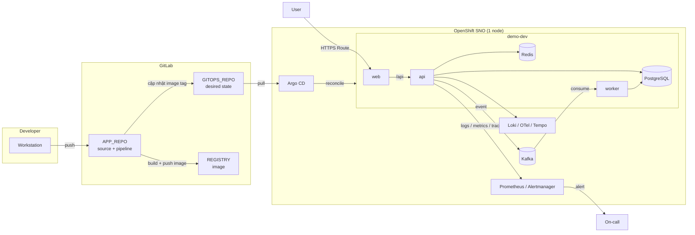
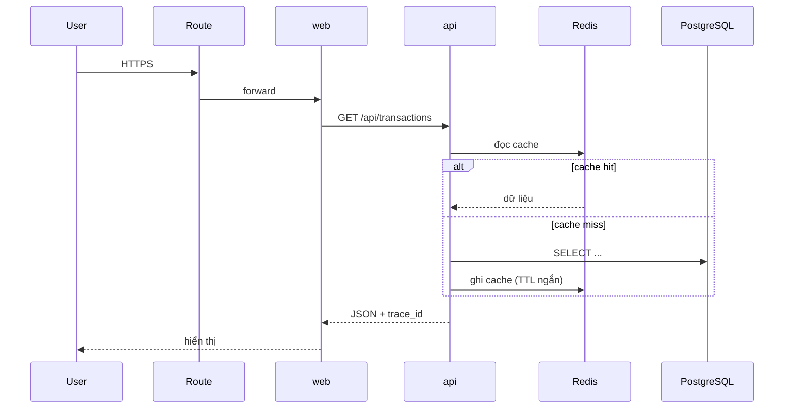
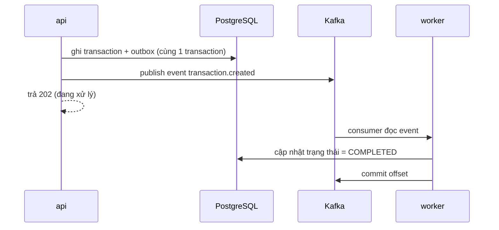
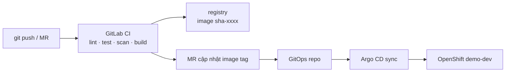
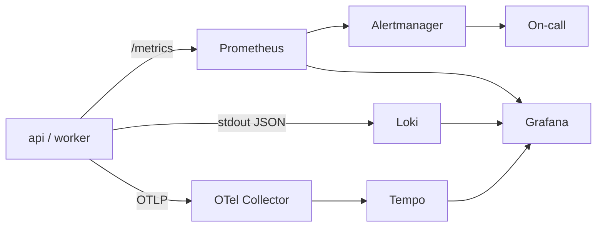
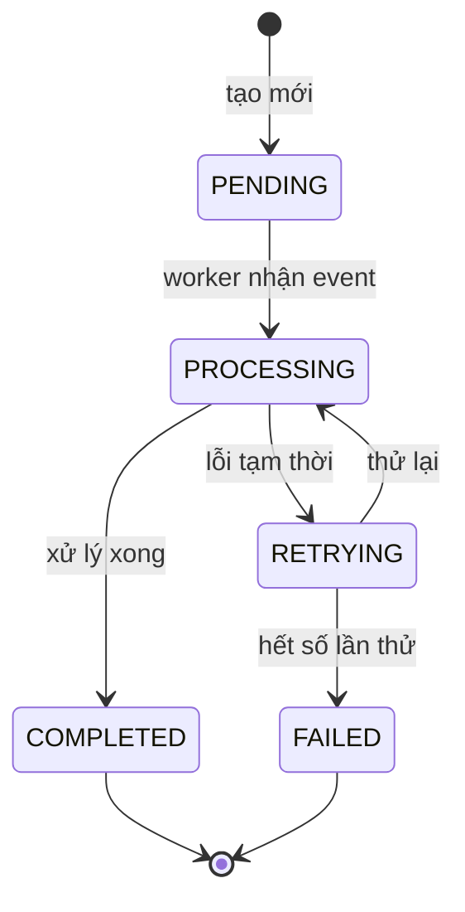
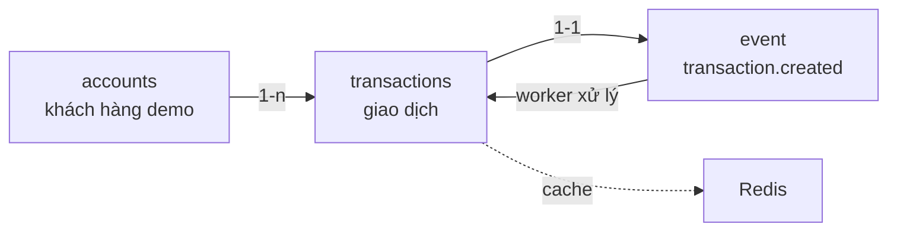

# Phase 0 - Thiết kế luồng và Preflight

> **Dự án:** Enterprise DevOps / SRE Lab trên VMware vSphere + OpenShift SNO
> **Mục tiêu tài liệu:** hiểu *luồng chạy* của hệ thống và *vai trò cốt lõi* của từng công nghệ trước khi cài bất cứ thứ gì.
> **Nguồn:** `enterprise-devops-sre-lab-plan.md` (mục 2-5, 10, 12, 15)
> **Trạng thái:** draft chờ xác nhận hạ tầng

---

## 1. Phase 0 làm gì

| Làm | Không làm |
|---|---|
| Vẽ luồng request, event, CI/CD, observability, backup | Không tạo VM, không cài OpenShift |
| Giải thích mỗi công nghệ giữ vai trò gì trong luồng | Không cấu hình DNS/NTP/firewall |
| Liệt kê thông tin hạ tầng cần xác nhận | Không chốt version/operator (chỉ ghi cần kiểm tra) |
| Chốt mô hình dữ liệu ở mức khái niệm | Không viết schema chi tiết, không migration |

**Nguyên tắc:** không tự bịa IP, domain, hostname, credential, registry. Mọi giá trị môi trường viết dạng placeholder `<TEN_BIEN>` và điền một lần khi đội hạ tầng xác nhận.

Placeholder dùng trong tài liệu: `<CLUSTER_NAME>`, `<BASE_DOMAIN>`, `<NODE_IP>`, `<APPS_WILDCARD>`, `<STORAGE_CLASS>`, `<REGISTRY_ENDPOINT>`, `<GITLAB_URL>`, `<PULL_SECRET_PATH>`.

---

## 2. Bức tranh tổng thể



### 2.1 Vai trò của từng công nghệ

| Công nghệ | Làm gì trong lab | Khái niệm quan trọng nhất |
|---|---|---|
| VMware vSphere | Nơi chạy VM; cấp vCPU/RAM/disk/network | VM không phải backup; snapshot không thay DR |
| OpenShift SNO | Kubernetes + nền tảng Red Hat trên **một node** | 1 node = **không HA**; node chết là mất cả lab |
| GitLab + GitLab CI | Lưu source, chạy pipeline build/test/scan | Pipeline chạy trên **runner**, không chạy trên cluster |
| Container registry | Lưu image bất biến theo tag commit | Image phải trace được về commit |
| Argo CD (OpenShift GitOps) | Kéo desired state từ Git rồi reconcile vào cluster | Git là nguồn duy nhất; cluster tự sửa về đúng Git |
| Prometheus | Thu thập và lưu metrics dạng time series | **Pull** qua `/metrics`, label quyết định chi phí |
| Grafana | Vẽ dashboard từ Prometheus/Loki/Tempo | Không lưu dữ liệu, chỉ truy vấn |
| Alertmanager | Nhận alert từ Prometheus, route tới người nhận | Alert phải có owner + runbook |
| Loki | Gom log theo label, tìm theo thời gian | Log phải JSON và có `trace_id` |
| OpenTelemetry + Tempo | Thu trace, nối một request qua nhiều service | Trace trả lời "chậm ở đâu", log trả lời "chi tiết gì" |
| Strimzi + Kafka | Event streaming giữa API và worker | Topic / partition / consumer group / lag |
| PostgreSQL | Nguồn dữ liệu chính (state) | Transaction, index, connection pool, backup |
| Redis | Cache đọc, giảm tải DB | Không phải source of truth; mất cache chỉ chậm |
| Vault (+ VSO) | Cấp secret runtime, không hardcode | Secret không bao giờ vào Git |

### 2.2 Ba lớp cần phân biệt

1. **Nền tảng (platform):** vSphere → OpenShift → operator → namespace.
2. **Workload (app):** web, api, worker, PostgreSQL, Redis, Kafka.
3. **Vận hành (ops):** CI/CD, observability, secret, backup.

Lỗi ở lớp nào thì troubleshoot ở lớp đó — đây là kỹ năng chính của SRE trên lab này.

---

## 3. Các luồng chính

### 3.1 F1 - Người dùng gọi ứng dụng (đồng bộ)



Điểm cần nắm:

- Đường đi **ngắn, đồng bộ**: user chờ kết quả nên mọi bước phải có **timeout**.
- Redis chỉ để **tăng tốc**; Redis chết thì API vẫn đọc DB và vẫn trả lời.
- Mỗi request có **trace_id** để nối metric → trace → log.

### 3.2 F2 - Xử lý event (bất đồng bộ)



Điểm cần nắm:

- **Producer** (api) và **consumer** (worker) tách rời: API không chờ worker.
- **Key = transaction_id** → cùng giao dịch vào cùng partition → giữ thứ tự.
- Giao hàng **at-least-once** (có thể trùng) → consumer phải **idempotent**.
- **Consumer lag** = hàng đợi còn tồn → metric quan trọng nhất của Kafka.
- Kafka chết không làm API fail ghi DB (nhờ outbox), chỉ làm chậm xử lý.

### 3.3 F3 - Từ code đến cluster (CI/CD + GitOps)



Điểm cần nắm — **ranh giới trách nhiệm**:

| Ai | Được làm | Không được làm |
|---|---|---|
| GitLab CI | build/test/scan/push image, tạo MR đổi tag | `oc apply`, giữ token cluster-admin |
| Argo CD | pull Git, reconcile vào cluster | build image |
| Người | merge MR | sửa trực tiếp trên cluster |

- **CI không deploy.** CI chỉ tạo ra image + một commit thay đổi desired state.
- **Rollback = git revert**, không phải sửa tay trên cluster.
- Sửa tay trên cluster → **drift** → Argo tự sửa lại (self-heal).

### 3.4 F4 - Observability (3 tín hiệu)



| Tín hiệu | Trả lời câu hỏi | Công cụ |
|---|---|---|
| Metrics | Hệ thống có đang khỏe? (rate, error, latency, saturation) | Prometheus + Grafana |
| Logs | Chuyện gì xảy ra ở request đó? | Loki |
| Traces | Thời gian mất ở service/bước nào? | OTel + Tempo |

Cả ba phải nối được bằng **trace_id**. Metric không dùng label như `account_id`/`transaction_id` (cardinality cao sẽ làm sập Prometheus).

### 3.5 F5 - Secret (đơn giản hóa)

- **Giai đoạn đầu:** tạo secret tay bằng `oc create secret` (không commit) — chấp nhận tạm thời.
- **Giai đoạn sau:** Vault giữ secret → Vault Secrets Operator đồng bộ thành Kubernetes Secret → pod đọc qua env/volume.
- App **không** gọi Vault trực tiếp; đổi lại khi rotate secret chỉ cần VSO sync.
- Baseline bắt buộc: không secret plaintext trong Git, không log secret.

### 3.6 F6 - Backup (đơn giản hóa)

| Dữ liệu | Cách bảo vệ | Ghi nhớ |
|---|---|---|
| PostgreSQL | dump định kỳ + diễn tập restore | Backup chỉ có giá trị khi restore được |
| Kubernetes resource | OADP/Velero (nếu tương thích) | Không thay thế backup dữ liệu |
| Desired state | Git | Nguồn dựng lại nhanh nhất |
| Kafka | retention + replay | Không phải database |
| VM | snapshot chỉ để thử nghiệm | **Không** dùng làm DR |

### 3.7 Khi một mắt xích chết thì sao

| Thành phần chết | Ảnh hưởng | Điều cần hiểu |
|---|---|---|
| Redis | Chậm hơn, không sai dữ liệu | Cache là optional |
| PostgreSQL | API/worker ghi đọc đều fail | Readiness fail, alert DB |
| Kafka | Event dồn lại, lag tăng | API vẫn nhận request |
| Worker | Event không được xử lý | Lag tăng → alert |
| Argo CD | Cluster giữ nguyên trạng thái | Không rollout mới |
| Node SNO | Toàn bộ workload + control plane chết | Giới hạn cố hữu của lab |

---

## 4. Luồng ứng dụng demo

### 4.1 Thành phần và nhiệm vụ

| Thành phần | Nhiệm vụ | Có state? |
|---|---|---|
| `web` | UI, gọi API | Không |
| `api` | Validate, ghi DB, publish event | Không |
| `worker` | Consume event, cập nhật trạng thái | Không |
| `postgres` | Nguồn dữ liệu chính | **Có** |
| `redis` | Cache đọc | Không (chấp nhận mất) |
| `kafka` | Event stream | Có (retention ngắn) |

### 4.2 Một request tạo giao dịch đi qua đâu

1. User bấm "Tạo giao dịch" trên `web`.
2. `web` gọi `api` kèm `Idempotency-Key`.
3. `api` validate → ghi `PENDING` vào PostgreSQL → publish event.
4. `api` trả `202` (đang xử lý) thay vì chờ worker.
5. `worker` xử lý event → cập nhật `COMPLETED` → user xem lại thấy trạng thái mới.

### 4.3 Trạng thái giao dịch



State machine là **hợp đồng** giữa api và worker: chỉ worker được đổi trạng thái, api chỉ tạo `PENDING`.

### 4.4 Endpoint tối thiểu

| Endpoint | Mục đích |
|---|---|
| `POST /api/transactions` | Tạo giao dịch |
| `GET /api/transactions/{id}` | Xem trạng thái |
| `GET /api/transactions` | Danh sách (phân trang) |
| `GET /health/live` | Pod còn sống (không kiểm tra DB) |
| `GET /health/ready` | Sẵn sàng nhận traffic (kiểm tra DB) |
| `GET /metrics` | Prometheus scrape |

### 4.5 Quy tắc vận hành bắt buộc

- **Liveness ≠ readiness:** liveness chỉ kiểm tra process; readiness kiểm tra dependency. Trộn hai cái sẽ tạo restart loop khi DB chết.
- **Requests/limits** cho mọi container; limit quá thấp → OOMKilled, request quá cao → không schedule được.
- **Graceful shutdown:** nhận `SIGTERM` → ngừng nhận request → xử lý nốt → thoát.
- **Idempotency:** request trùng key phải trả cùng kết quả, không tạo giao dịch thứ hai.
- **Log JSON + trace_id**, không log secret/payload nhạy cảm.

---

## 5. Dữ liệu ở mức khái niệm

### 5.1 Quan hệ dữ liệu



- `accounts`: danh mục tài khoản giả lập.
- `transactions`: bản ghi giao dịch + trạng thái (nguồn sự thật).
- Event: bản tin gửi Kafka, **không** phải nơi lưu dữ liệu chính.
- Redis: bản sao tạm, có TTL, luôn có thể sinh lại.

### 5.2 PostgreSQL

- Bảng chính: `accounts`, `transactions`; bảng phụ: bảng chống trùng event (`processed_events`) và outbox khi bật Kafka.
- Ba khái niệm phải nắm: **transaction** (nhóm ghi nguyên tử), **index** (đọc nhanh), **connection pool** (số kết nối có hạn — pool lớn hơn `max_connections` sẽ gây lỗi).
- Migration chạy bằng Job trước khi rollout app; migration phải tương thích ngược để rollback app không vỡ schema.

### 5.3 Redis

- Chỉ dùng cho: cache chi tiết giao dịch, cache danh sách, fast-path idempotency.
- Luôn có **TTL**; sau khi ghi DB phải xóa key liên quan (tránh dữ liệu cũ).
- Redis lỗi/timeout → API bỏ qua cache, đi thẳng DB.

### 5.4 Kafka

- Một topic chính `transaction-events`, một topic lỗi `transaction-events.dlq`.
- **Partition** quyết định mức song song; **consumer group** quyết định chia tải giữa các worker.
- **Lag** = mức tụt của consumer so với producer → SLI chính.
- Retention ngắn trong lab (ví dụ 24 h) để tiết kiệm disk; replay dùng để luyện xử lý sự cố.
- RF=1 trên SNO: **không phải HA**, phải ghi rõ trong runbook.

### 5.5 Ba câu hỏi dữ liệu luôn phải trả lời được

| Câu hỏi | Trả lời bằng |
|---|---|
| Dữ liệu đúng không? | PostgreSQL (nguồn sự thật) + test |
| Dữ liệu lớn bao nhiêu, giữ bao lâu? | Retention + alert dung lượng PVC 80/90% |
| Mất dữ liệu thì sao? | Backup + diễn tập restore (RPO/RTO) |

---

## 6. Preflight tối thiểu

### 6.1 Thông tin cần xác nhận trước Phase 1

| # | Thông tin | Nếu thiếu thì |
|---|---|---|
| 1 | Quyền tạo VM + capacity (vCPU/RAM/disk) | Không provision được |
| 2 | Port group / VLAN được phép | VM sai mạng |
| 3 | IP tĩnh, gateway, subnet | Không cài được node |
| 4 | DNS `api.<...>` + wildcard `*.apps.<...>` | Install fail, Route không vào được |
| 5 | NTP nội bộ | TLS/cert và etcd lỗi |
| 6 | Đường tới registry Red Hat (hoặc mirror), proxy/CA nếu có | Không pull được image |
| 7 | Pull secret + entitlement còn hạn | Không cài/tải được |
| 8 | OCP version được phép + cách cài | Không chốt được compatibility |
| 9 | StorageClass mặc định cho PVC | PostgreSQL/Kafka không có disk |
| 10 | GitLab/runner/registry: dùng chung hay tự dựng | Không có CI/CD |
| 11 | OCP version ↔ OpenShift GitOps ↔ Strimzi ↔ Vault tương thích | Cài xong mới phát hiện lỗi |

### 6.2 Kiểm tra nhanh (chỉ đọc, không thay đổi gì)

```bash
dig +short api.<CLUSTER_NAME>.<BASE_DOMAIN>
dig +short test.<APPS_WILDCARD>
chronyc tracking                 # clock synchronized?
nc -vz <NODE_IP> 6443
curl -sS -o /dev/null -w '%{http_code}\n' https://registry.redhat.io/v2/
test -f <PULL_SECRET_PATH> && echo "pull secret ok"
govc vm.info "<VM_NAME>"         # sau Phase 1: kiểm disk.EnableUUID
```

Kỳ vọng: DNS trả đúng IP; clock synchronized; `6443` mở; registry trả `200/401` (tới được, không timeout). Không mở port bằng tay — mọi thay đổi firewall phải qua Network team.

### 6.3 Điều kiện đóng Phase 0

- [ ] Đủ 11 thông tin ở 6.1, không còn giá trị `TBD`.
- [ ] Các lệnh 6.2 cho kết quả như kỳ vọng (có output làm bằng chứng).
- [ ] Compatibility matrix version được ghi lại (kèm link tài liệu chính thức).
- [ ] Luồng ở mục 3-5 được team review và đồng ý.
- [ ] Không có secret hay thông tin hạ tầng thật trong repo.

### 6.4 Quyết định cần chốt (ngắn)

| ID | Quyết định | Ghi chú |
|---|---|---|
| D-1 | OCP version + cách cài (Assisted / Agent-based) | Ảnh hưởng toàn bộ Phase 1 |
| D-2 | GitLab/runner/registry dùng chung hay tự dựng | Quyết định tài nguyên SNO |
| D-3 | Ngôn ngữ app | Không để việc học framework làm chậm lab |
| D-4 | Kafka: 1 broker, RF=1, chấp nhận không HA | Phải ghi rõ trong runbook |
| D-5 | Secret: tạm `oc create secret` → sau đó Vault + VSO | Không hardcode ở bất kỳ giai đoạn nào |

---

## 7. Bàn giao Phase 1

Phase 1 chỉ cần làm theo đúng những gì đã chốt:

1. Tạo VM theo sizing đã duyệt, bật `disk.EnableUUID`.
2. Cài SNO theo D-1, dùng IP/DNS/NTP đã xác nhận.
3. Kiểm tra: `oc get nodes`, `oc get clusteroperators`, `oc get storageclass`, test một PVC.
4. Ghi lại access/recovery notes + capacity thực tế sau khi platform khởi động.

Nếu capacity thực tế lệch nhiều so với dự kiến → cập nhật tài liệu **trước** khi sang Phase 2 (deploy app).
